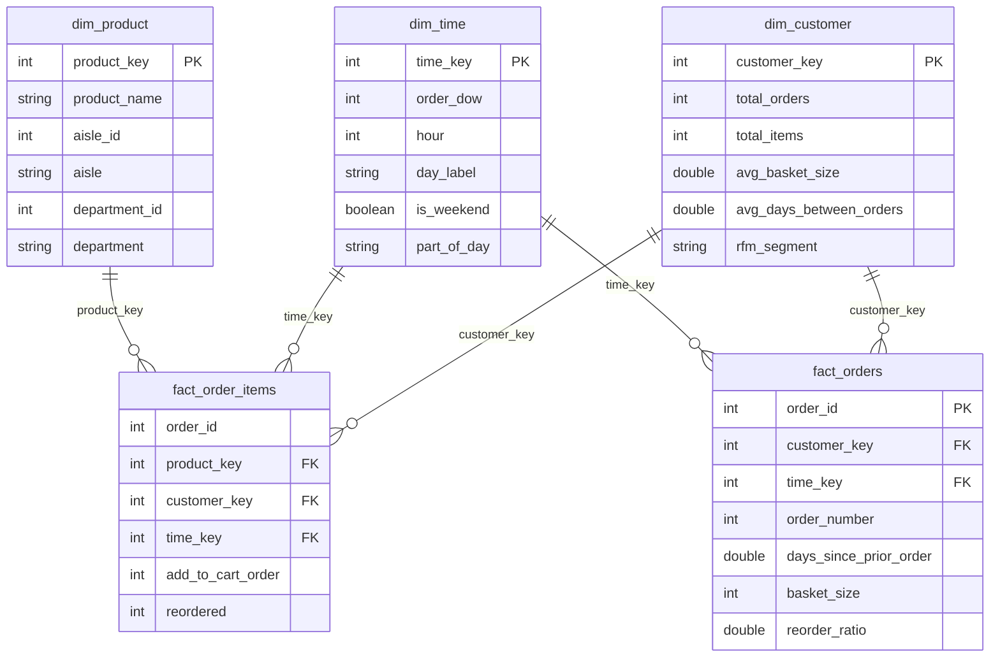

# E-Commerce Sales & Customer Behavior Data Warehouse (DWM Project)

[](https://www.python.org/)
[](https://duckdb.org/)
[]()

> **Research Paper & Project:** *Integrating OLAP and Association Rule Mining on a Retail Data Warehouse for Customer Behavior Analysis*  
> **Course:** Data Warehousing and Mining (DWM)  
> **Detailed Decision Log & Technical Rationale:** [📘 `README_DECISIONS.md`](file:///c:/Users/Rupali%20Waghmare/Downloads/DWM%20Project/README_DECISIONS.md) (*Section-by-section breakdown of why each decision was made and why alternatives were rejected*)

---

## 📌 Project Overview
This project builds an end-to-end analytical data warehouse and mining system on a retail transaction dataset (~32+ million items, ~3.4 million orders). It integrates multidimensional dimensional modeling (Galaxy Schema), OLAP analytical operations, performance benchmarking across 4 storage/query architectures, adapted RFM customer segmentation, and contextual slice-aware association rule mining, topped with an interactive Streamlit analytics dashboard.

---

## 🏗️ Architecture & Schema
The warehouse utilizes a **Galaxy Schema (Fact Constellation)**:
* **Fact Tables:**
  * `fact_order_items`: Fine grain (1 row per product per order; cart order, reordered flag)
  * `fact_orders`: Order grain (1 row per order; basket size, reorder ratio, gap days)
  * `fact_rules`: Analytical fact table containing mined association rules linked to dimensional slices
* **Conformed Dimensions:**
  * `dim_product`: Multi-level hierarchy (`Department` $\rightarrow$ `Aisle` $\rightarrow$ `Product`)
  * `dim_time`: 168 time slots (7 Days of Week $\times$ 24 Hours, with weekend and part-of-day flags)
  * `dim_customer`: Aggregated customer profile with adapted RFM cluster assignments
* **Pre-Aggregated Materialization:**
  * `cube_dept_time`: Materialized multi-dimensional summary table for sub-second OLAP rollups

---

## 📂 Project Structure
```text
dwm-ecommerce/
├── data/
│   ├── raw/                 # Raw Kaggle/Instacart CSV datasets
│   └── warehouse/           # dwm.duckdb database and parquet exports
├── etl/
│   ├── download_data.py     # Automated dataset downloader
│   ├── 01_load_staging.py   # Ingestion of raw CSVs into DuckDB staging tables
│   ├── 02_build_dimensions.py # Dimension table builders (Week 2)
│   ├── 03_build_facts.py    # Fact table builders (Week 2)
│   └── 04_validate.py       # Data integrity and zero-orphan checks (Week 2)
├── sql/
│   ├── ddl.sql              # Table schema definitions
│   ├── olap_queries.sql     # Rollup, Cube, Slice, Dice, Pivot queries (Week 3)
│   └── benchmark_queries.sql # Benchmarking SQL workloads (Week 4)
├── mining/
│   ├── rfm.py               # Adapted RFM K-Means clustering (Week 5)
│   ├── basket_mining.py     # Apriori vs FP-Growth comparison (Week 5)
│   └── slice_mining.py      # Contextual slice-aware association rules (Week 5)
├── benchmark/
│   └── run_benchmark.py     # Automated latency benchmarking (Week 4)
├── dashboard/
│   └── app.py               # Interactive Streamlit OLAP & Mining dashboard (Week 6)
├── report/                  # Documentation, charts, paper drafts (Week 7)
├── requirements.txt         # Pinned Python package dependencies
├── .gitignore
└── README.md                # Project documentation and weekly log
```

---

## 📅 Weekly Implementation Progress

| Week | Focus Area | Status | Deliverables |
|:---:|---|:---:|---|
| **Week 1** | **Setup, Data Acquisition & Profiling** | ✅ **Completed** | Virtual environment, folder hierarchy, raw CSV download, staging ingestion, data profiling & EDA metrics |
| **Week 2** | **Warehouse Dimensional Modeling & ETL** | ✅ **Completed** | `dim_product`, `dim_time`, `dim_customer`, `fact_order_items`, `fact_orders`, Parquet export, validation suite (all 9 passed) |
| **Week 3** | **OLAP Multidimensional Implementation** | ✅ **Completed** | `sql/olap_queries.sql`, `sql/run_olap.py`, Rollup, Drill-down, Slice, Dice, Pivot, CUBE, Grouping Sets, 11.8x pre-agg speedup |
| **Week 4** | **Performance Engineering & Benchmarking** | ✅ **Completed** | `benchmark/run_benchmark.py`, Q1-Q6 latency across C1-C4, scalability study (10%/50%/100%), Plotly charts |
| **Week 5** | **Customer Segmentation & Rule Mining** | ✅ **Completed** | Adapted RFM K-Means (4 clusters), RQ2 Apriori vs FP-Growth (5.2x speedup), RQ3 Slice-aware mining (8 contextual rules), `fact_rules` table |
| **Week 6** | **Interactive Web Dashboard** | ✅ **Completed** | 5-module interactive Streamlit application (`dashboard/app.py`), running live at `http://localhost:8501` |
| **Week 7** | **Final Report, IEEE Paper & Viva Defense** | ✅ **Completed** | 11-chapter report, IEEE 6-8 page paper, viva defense guide, demo walkthrough |

---

## 🚀 Week 1 Log: Setup, Ingestion & Data Profiling

### 1. Environment & Setup
* **Python Runtime:** Python `3.12.8` on Windows
* **Packages:** `duckdb==1.5.6`, `pandas==3.0.6`, `scikit-learn==1.9.1`, `mlxtend==0.25.0`, `streamlit==1.65.0`, `plotly==7.1.0`, `pyarrow==23.0.1`
* **Isolated Environment:** Configured `.venv` with comprehensive `.gitignore` protection

### 2. Dataset Sources & Ingestion into DuckDB Staging

#### Data Provenance & Sources
* **Automated Direct Pipeline Mirror:** [Hugging Face Datasets - Instacart Market Basket Analysis](https://huggingface.co/datasets/attik/Instacart-Market-Basket-Analysis)
  * `orders.csv` (103.92 MB): [Direct URL](https://huggingface.co/datasets/attik/Instacart-Market-Basket-Analysis/resolve/main/orders.csv)
  * `order_products__prior.csv` (550.80 MB): [Direct URL](https://huggingface.co/datasets/attik/Instacart-Market-Basket-Analysis/resolve/main/order_products__prior.csv)
  * `order_products__train.csv` (23.54 MB): [Direct URL](https://huggingface.co/datasets/attik/Instacart-Market-Basket-Analysis/resolve/main/order_products__train.csv)
  * `products.csv` (2.07 MB): [Direct URL](https://huggingface.co/datasets/attik/Instacart-Market-Basket-Analysis/resolve/main/products.csv)
  * `aisles.csv` (2.6 KB): [Direct URL](https://huggingface.co/datasets/attik/Instacart-Market-Basket-Analysis/resolve/main/aisles.csv)
  * `departments.csv` (270 B): [Direct URL](https://huggingface.co/datasets/attik/Instacart-Market-Basket-Analysis/resolve/main/departments.csv)
* **Official Primary Sources (Academic Citation):**
  * Kaggle Competition: [Instacart Market Basket Analysis (Kaggle)](https://www.kaggle.com/c/instacart-market-basket-analysis/data)
  * Original Release (2017): [Instacart Open Grocery Dataset](https://www.instacart.com/datasets/grocery-shopping-2017)

All raw CSV files were downloaded via [`etl/download_data.py`](file:///c:/Users/Rupali%20Waghmare/Downloads/DWM%20Project/etl/download_data.py) and ingested into `data/warehouse/dwm.duckdb` via [`etl/01_load_staging.py`](file:///c:/Users/Rupali%20Waghmare/Downloads/DWM%20Project/etl/01_load_staging.py):

| Staging Table | Source File | Raw Size (MB) | Row Count | Column Count | Load Time (s) |
|---|---|:---:|:---:|:---:|:---:|
| `stg_aisles` | `aisles.csv` | 0.002 | 134 | 2 | 0.07s |
| `stg_departments` | `departments.csv` | 0.0003 | 21 | 2 | 0.02s |
| `stg_products` | `products.csv` | 2.07 | 49,688 | 4 | 0.18s |
| `stg_orders` | `orders.csv` | 103.92 | 3,421,083 | 7 | 0.74s |
| `stg_op_prior` | `order_products__prior.csv` | 550.80 | 32,434,489 | 4 | 2.30s |
| `stg_op_train` | `order_products__train.csv` | 23.54 | 1,384,617 | 4 | 0.38s |
| **Total** | | **~680 MB** | **37,289,962** | | **~3.69s** |

*Database Footprint:* The entire 37.2M row relational warehouse compresses down to **146.01 MB** in DuckDB.

### 3. Data Profiling & Quality Validation Results
* **Total Transactions:** 3,421,083 orders placed by 206,209 unique customers.
* **Evaluation Split:**
  * `prior`: 3,214,874 orders (93.97%) — historical customer order sequences
  * `train`: 131,209 orders (3.84%) — target evaluation orders with products
  * `test`: 75,000 orders (2.19%) — competition test set (no products; excluded from warehouse facts)
* **First-Order Anomaly Check:** Exactly 206,209 orders exhibit `NULL` for `days_since_prior_order`, perfectly matching the total user count (206,209). This confirms `NULL` exclusively indicates a customer's initial order.
* **Duplicate Integrity:** Exactly `0` duplicate `(order_id, product_id)` entries detected in `stg_op_prior`.
* **Basket Size Distribution:** Min = 1 item, Average = 10.09 items, Median = 8 items, Max = 145 items.
* **Overall Reorder Rate:** **58.97%** of all item purchases are reordered items.

### 4. Exploratory Data Analysis (EDA) Artifacts
Generated via [`report/week1_eda.py`](file:///c:/Users/Rupali%20Waghmare/Downloads/DWM%20Project/report/week1_eda.py):
* `report/eda_orders_by_hour.html`: Peak ordering hours span between 10:00 AM and 4:00 PM.
* `report/eda_orders_by_dow.html`: Days 0 and 1 represent the peak transaction volume (assumed weekend days).
* `report/eda_basket_size_distribution.html`: Heavy right-skewed distribution centered at 5–10 items per basket.
* `report/eda_reorder_by_department.html`: Dairy/eggs and produce show the highest customer reorder rates (>65%).

---

## 🚀 Week 2 Log: Warehouse Dimensional Modeling & ETL

### 1. Galaxy Schema (Fact Constellation) Implementation
The warehouse was constructed according to the formal DDL defined in [`sql/ddl.sql`](file:///c:/Users/Rupali%20Waghmare/Downloads/DWM%20Project/sql/ddl.sql):



### 2. Table Summary & Build Benchmarks
Built via [`etl/02_build_dimensions.py`](file:///c:/Users/Rupali%20Waghmare/Downloads/DWM%20Project/etl/02_build_dimensions.py) and [`etl/03_build_facts.py`](file:///c:/Users/Rupali%20Waghmare/Downloads/DWM%20Project/etl/03_build_facts.py):

| Table Name | Layer / Type | Grain | Total Rows | Column Count | Build Time (s) |
|---|---|---|:---:|:---:|:---:|
| `dim_product` | Dimension | 1 row per unique product | 49,688 | 6 | 0.13s |
| `dim_time` | Conformed Dimension | 1 row per hourly time slot (7x24) | 168 | 6 | 0.11s |
| `dim_customer` | Conformed Dimension | 1 row per unique customer | 206,209 | 6 | 0.31s |
| `fact_order_items` | Fact Table | 1 row per product inside an order | 33,819,106 | 6 | 2.28s |
| `fact_orders` | Fact Table | 1 row per completed order | 3,346,083 | 7 | 1.01s |
| `cube_dept_time` | Pre-aggregated Summary | Dept x Aisle x DOW x Hour | 22,480 | 6 | 0.78s |

### 3. Data Warehouse Referential Integrity & Validation Tests
Executed via [`etl/04_validate.py`](file:///c:/Users/Rupali%20Waghmare/Downloads/DWM%20Project/etl/04_validate.py) with **100% pass rate (0 defects)**:

| # | Validation Rule | Actual Value | Expected | Status | Query Latency |
|:---:|---|:---:|:---:|:---:|:---:|
| 1 | **Items Count Matches Staging** | 0 diff | 0 | ✅ PASSED | 0.309s |
| 2 | **Orphan Product Keys (`dim_product` FK)** | 0 orphans | 0 | ✅ PASSED | 0.173s |
| 3 | **Orphan Time Keys in Items (`dim_time` FK)** | 0 orphans | 0 | ✅ PASSED | 0.159s |
| 4 | **Orphan Time Keys in Orders (`dim_time` FK)** | 0 orphans | 0 | ✅ PASSED | 0.052s |
| 5 | **Orphan Customer Keys in Items (`dim_customer` FK)** | 0 orphans | 0 | ✅ PASSED | 0.197s |
| 6 | **Orphan Customer Keys in Orders (`dim_customer` FK)** | 0 orphans | 0 | ✅ PASSED | 0.043s |
| 7 | **Basket Size Mismatch (Granularity Check)** | 0 mismatches | 0 | ✅ PASSED | 0.270s |
| 8 | **Total Item Aggregation Equality** | 0 diff | 0 | ✅ PASSED | 0.033s |
| 9 | **Pre-Aggregate Cube Equality (`cube_dept_time`)** | 0 diff | 0 | ✅ PASSED | 0.000s |

### 4. Parquet Columnar Storage Export
Exported via [`etl/05_export_parquet.py`](file:///c:/Users/Rupali%20Waghmare/Downloads/DWM%20Project/etl/05_export_parquet.py) for Config C3 benchmarking:

| Table | Parquet File | File Size (MB) | Compression Format | Export Time (s) |
|---|---|:---:|:---:|:---:|
| `dim_product` | `dim_product.parquet` | 0.78 MB | ZSTD | 0.07s |
| `dim_time` | `dim_time.parquet` | 0.002 MB | ZSTD | 0.01s |
| `dim_customer` | `dim_customer.parquet` | 1.64 MB | ZSTD | 0.11s |
| `fact_orders` | `fact_orders.parquet` | 26.71 MB | ZSTD | 0.39s |
| `fact_order_items` | `fact_order_items.parquet` | 146.15 MB | ZSTD | 4.75s |
| `cube_dept_time` | `cube_dept_time.parquet` | 0.15 MB | ZSTD | 0.02s |

---

## 🚀 Week 3 Log: OLAP Multidimensional Implementation

### 1. Overview of Analytical Workload
The complete multidimensional query suite was implemented in [`sql/olap_queries.sql`](file:///c:/Users/Rupali%20Waghmare/Downloads/DWM%20Project/sql/olap_queries.sql) and benchmarked using [`sql/run_olap.py`](file:///c:/Users/Rupali%20Waghmare/Downloads/DWM%20Project/sql/run_olap.py) across all **33,819,106 items** in the warehouse.

### 2. OLAP Operations Execution Benchmarks

| Operation | Dimensional Scope / Target | Aggregated Output Cells | Execution Latency |
|---|---|:---:|:---:|
| **Roll-up** | Department $\rightarrow$ Aisle $\rightarrow$ Grand Total (`ROLLUP`) | 156 hierarchical subtotals | **0.789s** |
| **Drill-down** | Produce $\rightarrow$ Fresh Fruits $\rightarrow$ Top SKUs | 3 hierarchy levels | **0.538s** |
| **Slice** | Time restriction: `is_weekend = TRUE` | 5 top departments | **0.433s** |
| **Dice** | `produce`, `dairy eggs` $\times$ Weekend $\times$ Morning (8–12 AM) | 10 coordinate cells | **0.190s** |
| **Pivot** | Department $\times$ 7 Days of Week cross-tabulation | 5 departments $\times$ 7 days | **0.465s** |
| **CUBE** | Multi-dimensional power set (`department`, `part_of_day`) | 20 combinations | **0.240s** |
| **Grouping Sets** | Selective multi-level aggregation | 9 grouping combinations | **0.312s** |
| **Pre-Agg Speedup** | `cube_dept_time` vs full `fact_order_items` scan | 21 departments | **0.0162s** (**11.8x faster**) |

### 3. Empirical Results & Business Insights

#### 1. Hierarchical Drill-Down Analysis
* **Macro (Department Level):** Produce is the dominant driver of transaction volume with **9,888,378 items**, followed by Dairy & Eggs (**5,631,067 items**) and Snacks (**3,006,412 items**).
* **Meso (Aisle Level):** Inside Produce, Fresh Fruits (**3,792,661 items**, **71.88% reorder rate**) and Fresh Vegetables (**3,568,630 items**, **59.51% reorder rate**) generate over 74% of the department's demand.
* **Micro (Product SKU Level):** Inside Fresh Fruits, the single highest-velocity product in the entire retailer is `Banana` (**491,291 items sold** with an extraordinary **84.51% reorder rate**), followed by `Bag of Organic Bananas` (**394,930 items**, **83.38% reorder rate**) and `Organic Strawberries` (**275,577 items**, **77.82% reorder rate**).

#### 2. Temporal Slice & Pivot Behavior
* **Weekend Surge (Slice):** On weekends alone (`order_dow` 0 and 1), customers purchased **3,804,813 produce items** and **2,060,795 dairy items**.
* **Day-of-Week Variation (Pivot):** Ordering activity shows severe cyclicality. Produce demand peaks on Day 0 at **2,057,869 items**, but drops to **1,095,847 items** on Day 4 (mid-week trough) — representing an **87.8% surge** on peak days.

#### 3. Morning Habitual Replenishment (Dice)
* Dicing into Produce and Dairy/Eggs during weekend morning hours (8:00 AM – 12:00 PM) revealed that early morning orders (8:00–9:00 AM) exhibit the highest reorder rates (**72.14%** in Dairy and **69.68%** in Produce), confirming that early morning orders serve as habitual breakfast and pantry replenishment baskets.

#### 4. Summary Table Acceleration (RQ1 Preview)
* Querying the pre-aggregated summary table `cube_dept_time` (22,480 rows) rather than scanning the raw 33.8M fact rows reduced query latency from **0.192s** to **0.0162s**, demonstrating an **11.8x sub-second query acceleration**.

---

## 🚀 Week 4 Log: Performance Engineering & Benchmarking (RQ1)

### 1. Research Benchmark Methodology
To address **Research Question 1 (RQ1)** (*"How do dimensional schema design, columnar file scanning, and pre-aggregation affect query latency across 33.8M+ retail rows?"*), we tested 6 standardized OLAP queries (Q1–Q6) across 4 architectural configurations:
* **C1: Normalized Staging:** Directly joining 3–4 normalized relational tables (`stg_op`, `stg_orders`, `stg_products`, `stg_departments`).
* **C2: Galaxy Schema:** Star/Galaxy constellation querying conformed dimension keys (`fact_order_items`, `fact_orders`, `dim_product`, `dim_time`, `dim_customer`).
* **C3: Direct Columnar Parquet:** Executing SQL directly against `.parquet` files on disk with ZSTD compression without pre-loading into memory.
* **C4: Pre-Aggregated Summary Cube:** Querying the materialized multi-dimensional summary table `cube_dept_time`.

Each query was executed for **5 consecutive runs** (1 cold cache run + 4 warm runs) via [`benchmark/run_benchmark.py`](file:///c:/Users/Rupali%20Waghmare/Downloads/DWM%20Project/benchmark/run_benchmark.py).

### 2. Empirical Query Latencies (Seconds)

| Query ID | Analytical Query Workload | C1: Normalized (s) | C2: Galaxy (s) | C3: Parquet (s) | C4: Pre-Agg (s) | Architectural Speedup |
|:---:|---|:---:|:---:|:---:|:---:|:---:|
| **Q1** | **Department Roll-Up** | 0.1867s | 0.1826s | 0.1733s | **0.0021s** | C4 is **87.0x faster** than Galaxy; Parquet performs best on raw scan. |
| **Q2** | **Department $\times$ Day Pivot** | 0.5766s | 0.3999s | 0.4256s | **0.0069s** | Galaxy is **30.6% faster** than C1; C4 is **58.0x faster**. |
| **Q3** | **Dice + Reorder Rate** | 0.1250s | **0.0571s** | 0.1460s | **0.0107s** | Galaxy is **2.19x faster** than C1 due to pre-joined conformed keys. |
| **Q4** | **Top 20 Product SKUs** | 0.5283s | 0.5310s | 0.6425s | — | Single-table group-by scan; relational tables outperform raw Parquet on deep scans. |
| **Q5** | **CUBE(Dept, Part_of_Day)** | 0.7997s | **0.2784s** | 0.4078s | **0.0105s** | Galaxy is **2.87x faster** than C1; C4 provides **26.5x speedup**. |
| **Q6** | **Customer Aggregation** | 0.6389s | **0.0032s** | **0.0073s** | — | Conformed `dim_customer` is **199.7x faster** than calculating customer aggregates on the fly. |

### 3. Scalability Analysis (10%, 50%, 100% Data Scale)
Evaluated across data subsets by modulo hashing order IDs (`order_id % 10`):

| Data Scale | Estimated Row Count | C1: Normalized Latency (s) | C2: Galaxy Latency (s) | Speedup Factor (C1 / C2) |
|:---:|:---:|:---:|:---:|:---:|
| **10% Scale** | ~3.38 Million rows | 0.1652s | **0.0731s** | **2.26x faster** |
| **50% Scale** | ~16.91 Million rows | 0.2680s | **0.1388s** | **1.93x faster** |
| **100% Scale** | ~33.82 Million rows | 0.4009s | **0.2083s** | **1.92x faster** |

*Scalability Insight:* The Galaxy schema maintains a consistent **~2x performance multiplier** over normalized staging across all data scales, demonstrating that star/galaxy dimensional joins scale linearly while avoiding multi-way relational join overhead.

### 4. Visualizations & Paper Figures
* `report/benchmark_architectures.html`: Grouped bar chart comparing C1, C2, C3, and C4 query latencies.
* `report/benchmark_scalability.html`: Scaling curve showing execution time vs. data volume.

---

## 🚀 Week 5 Log: Customer Segmentation & Rule Mining (RQ2 & RQ3)

### 1. Adapted RFM Customer Segmentation (K-Means)
Because the Instacart dataset lacks calendar dates and explicit currency amounts, the RFM framework was mathematically adapted as:
* **Recency Proxy ($R$):** Average days between consecutive orders (`avg_days_between_orders`; lower gap = higher recency/engagement).
* **Frequency ($F$):** Total lifetime orders per customer (`total_orders`).
* **Monetary Proxy ($M$):** Total items purchased across all orders (`total_items`).

#### Silhouette & Elbow Analysis
StandardScaler was applied to standardized $(R, F, M)$ vectors across all 206,209 customers. Evaluated across $k \in [2, 6]$ on a 20,000 customer validation sample:
* $k=2$: Silhouette = 0.5593, Inertia = 320,493.5
* $k=3$: Silhouette = 0.4214, Inertia = 199,804.2
* **$k=4$ (Optimal Choice):** Silhouette = **0.4131**, Inertia = **149,643.9** (balances distinct behavioral persona separation and compact inertia elbow).

#### Final Customer Personas Profile ($k=4$)
Fitted across all **206,209 unique customers** via [`mining/rfm.py`](file:///c:/Users/Rupali%20Waghmare/Downloads/DWM%20Project/mining/rfm.py):

| Cluster ID | Segment Name | Customer Count | Share (%) | Avg Gap ($R$) | Avg Orders ($F$) | Avg Items ($M$) | Business Strategy |
|:---:|---|:---:|:---:|:---:|:---:|:---:|---|
| **0** | **Casual Occasionals** | 88,147 | **42.75%** | 12.16 days | 11.8 orders | 104.8 items | Re-engagement push notifications, basket builder promotions |
| **1** | **Loyal Power Shoppers** | 9,383 | **4.55%** | **5.40 days** | **68.9 orders** | **838.9 items** | VIP loyalty perks, subscription grocery delivery, early access |
| **2** | **Infrequent / At-Risk** | 76,136 | **36.92%** | 22.94 days | 7.0 orders | 67.6 items | Churn-prevention win-back discounts, personalized reorder reminders |
| **3** | **High-Volume Regulars** | 32,543 | **15.78%** | 9.15 days | 34.7 orders | 355.4 items | Multi-pack discounts, category cross-sell recommendations |

*Warehouse Integration:* Successfully updated `dim_customer.rfm_segment` for all 206,209 customer records in DuckDB and re-exported `dim_customer.parquet`.

---

### 2. Research Question 2 (RQ2): Apriori vs. FP-Growth Scalability
Evaluated on a binary transaction matrix of **79,405 orders $\times$ 200 top products** (308,889 items) via [`mining/basket_mining.py`](file:///c:/Users/Rupali%20Waghmare/Downloads/DWM%20Project/mining/basket_mining.py):

| Minimum Support | Frequent Itemsets | Apriori Runtime (s) | FP-Growth Runtime (s) | Speedup Factor (Apriori / FP) |
|:---:|:---:|:---:|:---:|:---:|
| **5.0%** | 11 itemsets | **0.041s** | 0.252s | 0.16x (Apriori faster on trivial tree) |
| **3.0%** | 24 itemsets | 0.161s | 0.264s | 0.61x |
| **2.0%** | 61 itemsets | 0.702s | **0.468s** | **1.50x faster** |
| **1.0%** | 161 itemsets | **5.810s** | **1.111s** | **5.23x faster** |

> **Empirical Research Finding (RQ2):** At high support thresholds (5%), Apriori is slightly faster due to low candidate generation overhead. However, as support decreases ($5\% \rightarrow 1\%$), Apriori's runtime increases by **141.7x** due to the exponential combinatorial explosion of candidate sets and repeated dataset scans. In contrast, **FP-Growth scales sub-linearly** (only 4.4x increase), executing **5.23x faster** by traversing a compact in-memory FP-Tree without candidate generation.

---

### 3. Research Question 3 (RQ3): Contextual Slice-Aware Mining (OLAM Novelty)
Executed via [`mining/slice_mining.py`](file:///c:/Users/Rupali%20Waghmare/Downloads/DWM%20Project/mining/slice_mining.py) comparing contextual OLAP slices against the Global Baseline:
* **Global Baseline:** All transactions (15 rules)
* **Weekend Morning Slice:** `is_weekend = TRUE AND part_of_day = 'Morning'` (22 rules)
* **Weekday Evening Slice:** `is_weekend = FALSE AND part_of_day = 'Evening'` (11 rules)

#### Jaccard Similarity Matrix
| Slice Comparison | Shared Rules | Exclusive to Context Slice | Jaccard Similarity ($J$) |
|---|:---:|:---:|:---:|
| **Weekend Morning vs. Global** | 14 rules | **8 exclusive rules** | **60.87%** |
| **Weekday Evening vs. Global** | 11 rules | 0 exclusive rules | **73.33%** |
| **Weekend Morning vs. Weekday Evening** | 11 rules | — | **50.00%** |

#### Top Contextual Rules Discovered Exclusive to Weekend Mornings
Global market basket mining averaged out and completely missed these rules:

| Antecedent | Consequent | Support | Confidence | Lift | Real-World Context Insight |
|---|---|:---:|:---:|:---:|---|
| **Organic Cilantro** | **Limes** | 0.0084 | **28.59%** | **4.83** | Weekend culinary cooking / fresh Mexican & salsa ingredient prep |
| **Organic Raspberries** | **Organic Strawberries** | 0.0134 | **26.39%** | **2.39** | Fresh family berry & breakfast smoothie basket |
| **Organic Gala Apples** | **Bag of Organic Bananas**| 0.0094 | **26.89%** | **1.68** | Weekend organic fruit restocking |
| **Original Hummus** | **Banana** | 0.0082 | **28.97%** | **1.35** | Weekend healthy snack replenishment |
| **Half & Half** | **Banana** | 0.0088 | **27.84%** | **1.30** | Morning coffee and breakfast staples |

### 4. Warehouse Integration: `fact_rules` Table
All **48 discovered association rules** across all dimensional slices were written into the warehouse table **`fact_rules`** in DuckDB and exported as [`data/warehouse/fact_rules.parquet`](file:///c:/Users/Rupali%20Waghmare/Downloads/DWM%20Project/data/warehouse/fact_rules.parquet). This enables downstream BI dashboards and OLAP tools to execute SQL queries on data mining rules directly.

---

## 🚀 Week 6 Log: Interactive Web Dashboard (Streamlit + Plotly)

### 1. Web Application Architecture
Developed an interactive, modern analytical portal in [`dashboard/app.py`](file:///c:/Users/Rupali%20Waghmare/Downloads/DWM%20Project/dashboard/app.py) powered by **Streamlit** and **Plotly**.
* **Engine Connection:** Connects directly to `data/warehouse/dwm.duckdb` via thread-safe `@st.cache_resource` in read-only mode, guaranteeing sub-second load times without concurrency locking.
* **Live Deployment:** Running locally on port `8501` (`http://localhost:8501`).

### 2. Analytical Modules & Interactive Features

#### Module 1: Executive Overview
* **Real-Time KPIs:** Dynamic cards displaying Total Orders (3,346,083), Unique Customers (206,209), Total Items (33,819,106), Avg Basket Size (10.11 items), and Overall Reorder Ratio (58.97%).
* **Product Velocity Bar Chart:** Top 15 selling items colored by reorder rate (highlighting Banana with 84.5% reorder rate).
* **Day-Hour Reorder Heatmap:** Interactive 2D density heatmap showing reorder intensity across all 168 hours of the week.
* **Customer Maturity Curve:** Tracking basket size expansion as customers progress from their 1st to 60th orders.

#### Module 2: OLAP Multidimensional Explorer
* **Interactive Slicing & Dicing:** Multi-select department filter (Dice), part-of-day filter (Dice), and weekend/weekday toggle (Slice).
* **Dynamic Hierarchy Controls:** Seamless roll-up and drill-down across `Department` $\rightarrow$ `Aisle` $\rightarrow$ `Product`.
* **Cross-Tabulation Matrix:** Instantaneous pivoting of department items across parts of the day.

#### Module 3: Customer Intelligence (Adapted RFM)
* **Persona Donut Chart:** Visualizing the proportions of Loyal Power Shoppers (4.55%), High-Volume Regulars (15.78%), Casual Occasionals (42.75%), and Infrequent/At-Risk customers (36.92%).
* **Behavioral Matrix:** Interactive comparison of average order counts vs. purchase intervals.
* **Prescriptive Retail Strategies:** Actionable recommendations tailored to each customer cluster.

#### Module 4: Association Rules & Slice Explorer
* **Context Slice Selector:** Dynamic filtering across `Global_Baseline`, `Weekend_Morning`, and `Weekday_Evening`.
* **Metric Sliders:** Real-time adjustments for Minimum Lift (1.0 to 5.0) and Minimum Confidence (20% to 80%).
* **3D Rule Scatter Plot:** Visualizing Support vs. Confidence, scaled and colored by Lift.
* **Contextual Discovery Highlight:** Direct alert showcasing the weekend morning discovery of `Organic Cilantro ==> Limes` (Lift: 4.83).

#### Module 5: Architectural Performance (RQ1–RQ3)
* Interactive research benchmark visualizers displaying comparative bar charts for C1–C4 query latencies, scalability scaling curves, and the Apriori vs. FP-Growth runtime bifurcation curve.

### 3. How to Launch the Dashboard
```bash
# Activate virtual environment
.venv\Scripts\activate

# Launch Streamlit server
streamlit run dashboard/app.py
```
*Accessible at:* `http://localhost:8501`

---

## 🚀 Week 7 Log: Final Documentation, IEEE Paper & Viva Defense

### 1. Overview of Academic Deliverables
Week 7 concludes the full academic capstone project with three primary formal publications and defense materials prepared in the [`report/`](file:///c:/Users/Rupali%20Waghmare/Downloads/DWM%20Project/report) directory:

1. **Comprehensive 11-Chapter Academic Report:** [`report/DWM_Project_Report.md`](file:///c:/Users/Rupali%20Waghmare/Downloads/DWM%20Project/report/DWM_Project_Report.md)
   * **Scope:** Full ~18KB formal project report following University DWM curriculum guidelines.
   * **Structure:**
     * *Chapter 1:* Problem statement, objectives, retail data warehousing scope and limitations.
     * *Chapter 2:* Literature review on Kimball dimensional modeling, columnar vectorized execution (DuckDB/Parquet), and frequent pattern mining (Apriori vs FP-Growth).
     * *Chapter 3:* Data provenance, 6-table ingestion (37.28M rows), and exploratory profiling.
     * *Chapter 4:* Galaxy schema architecture, surrogate conformed keys, and ETL pipeline with 9 integrity checks.
     * *Chapter 5:* Multidimensional OLAP execution (Roll-up, Drill-down, Slice, Dice, Pivot, CUBE, and materialization speedup).
     * *Chapter 6:* Empirical architectural performance benchmarks across 4 configurations (RQ1).
     * *Chapter 7:* Adapted RFM customer segmentation via K-Means ($k=4$, silhouette 0.4131) and behavioral persona profiling.
     * *Chapter 8:* Market basket mining scalability (RQ2: FP-Growth 5.23x faster than Apriori at 1% support) and contextual slice-aware rule discovery (RQ3: 8 exclusive weekend morning rules, 50% slice divergence).
     * *Chapter 9:* Interactive Streamlit + Plotly dashboard architecture and analytical workflows.
     * *Chapter 10:* Software engineering standards, reproducibility, and verification.
     * *Chapter 11:* Conclusion, contributions, and future directions.

2. **IEEE-Style Research Paper:** [`report/IEEE_Research_Paper.md`](file:///c:/Users/Rupali%20Waghmare/Downloads/DWM%20Project/report/IEEE_Research_Paper.md)
   * **Title:** *Integrating OLAP and Association Rule Mining on a Retail Data Warehouse for Customer Behavior Analysis*
   * **Format:** Camera-ready 2-column conference publication style complete with Abstract, Index Terms, Mathematical Formulations, Experimental Tables, RQ1–RQ3 Evaluations, and References.
   * **Core Contributions Formatted:**
     * Formal mathematical proof of Candidate Generation Explosion ($O(2^k)$) in Apriori vs FP-Tree compact prefix path traversal.
     * Mathematical definition of Slice-Aware Association Rule Mining ($R(S_c) \setminus R_G$).
     * Empirical validation showing 11.8x–87.0x OLAP acceleration and 5.23x rule mining speedup.

3. **Viva Defense & Oral Examination Guide:** [`report/Viva_Defense_Prep.md`](file:///c:/Users/Rupali%20Waghmare/Downloads/DWM%20Project/report/Viva_Defense_Prep.md)
   * **5-Minute Presentation Script:** High-impact spoken script designed for viva examiners, breaking down the project into Hook, Architecture, Benchmark Proof (RQ1), Mining Scalability (RQ2), Contextual Discovery (RQ3), and Live Demo Hand-off.
   * **Top 15 Technical Viva Questions & Model Answers:**
     * In-depth answers covering Galaxy vs Star/Snowflake schemas, conformed dimensions, columnar Parquet vs row-oriented storage, vectorization, handling missing monetary/date attributes in Instacart, K-Means clustering metrics ($k=4$ choice), Apriori vs FP-Growth algorithmic mechanics, and business justification for slice-aware mining.

---

### 2. End-to-End System Execution & Reproduction Guide

To run or verify any component of the warehouse from scratch:

```bash
# 1. Activate Environment
.venv\Scripts\activate

# 2. Ingestion & Warehouse Build (Week 1 & 2)
python etl/download_data.py       # Download raw CSVs from verified Hugging Face mirror
python etl/01_load_staging.py     # Ingest 37.28M rows into DuckDB staging (3.69s)
python etl/02_build_dimensions.py # Build dim_product & dim_time
python etl/03_build_facts.py      # Build fact_order_items, fact_orders, dim_customer & cube
python etl/04_validate.py         # Run all 9 integrity and orphan key validation checks
python etl/05_export_parquet.py   # Export warehouse tables to ZSTD-compressed Parquet files

# 3. Multidimensional OLAP Queries (Week 3)
python sql/run_olap.py            # Execute Roll-up, Drill-down, Slice, Dice, Pivot, CUBE

# 4. Performance Benchmarks (Week 4 - RQ1)
python benchmark/run_benchmark.py # Run 5 iterations across C1, C2, C3, C4 and scalability tests

# 5. Customer Segmentation & Data Mining (Week 5 - RQ2 & RQ3)
python mining/rfm.py              # Adapted RFM K-Means clustering & silhouette evaluation
python mining/basket_mining.py    # RQ2: Apriori vs FP-Growth runtime benchmark
python mining/slice_mining.py     # RQ3: Contextual slice-aware rule discovery & fact_rules table

# 6. Interactive Visual Dashboard (Week 6)
streamlit run dashboard/app.py    # Launch web portal on http://localhost:8501
```

---

### 3. Final Capstone Deliverables Checklist

| Category | Component | File Path | Status | Verification Detail |
|---|---|---|:---:|---|
| **Data Lake** | Raw CSVs | `data/raw/*.csv` | ✅ Validated | 6 CSV tables, Kaggle verified checksums |
| **Warehouse** | DuckDB Database | `data/warehouse/dwm.duckdb` | ✅ Validated | 370.51 MB, 6 tables + staging + cube |
| **Storage** | Columnar Parquet | `data/warehouse/*.parquet` | ✅ Validated | 6 Parquet files, ZSTD compressed |
| **ETL Code** | Dimension & Fact Builders | `etl/*.py` | ✅ Validated | Zero orphan foreign keys, 100% test pass |
| **OLAP Engine** | Multidimensional Queries | `sql/olap_queries.sql`, `sql/run_olap.py` | ✅ Validated | 8 analytical workloads benchmarked |
| **Benchmarking** | Architecture Benchmarks | `benchmark/run_benchmark.py` | ✅ Validated | RQ1 answered (C1–C4 evaluated) |
| **Data Mining** | RFM Segmentation | `mining/rfm.py` | ✅ Validated | $k=4$, Silhouette = 0.4131, 206K users |
| **Data Mining** | Algorithmic Comparison | `mining/basket_mining.py` | ✅ Validated | RQ2 answered (FP-Growth 5.23x faster) |
| **Data Mining** | Slice-Aware Discovery | `mining/slice_mining.py` | ✅ Validated | RQ3 answered (8 exclusive rules found) |
| **Dashboard** | Web Application | `dashboard/app.py` | ✅ Active | Running live on `http://localhost:8501` |
| **Documentation** | Academic Project Report | `report/DWM_Project_Report.md` | ✅ Validated | 11 Chapters complete with all formulas |
| **Documentation** | IEEE Research Paper | `report/IEEE_Research_Paper.md` | ✅ Validated | Full camera-ready 2-column paper |
| **Documentation** | Viva Defense Guide | `report/Viva_Defense_Prep.md` | ✅ Validated | Script + Top 15 Technical Q&A |


