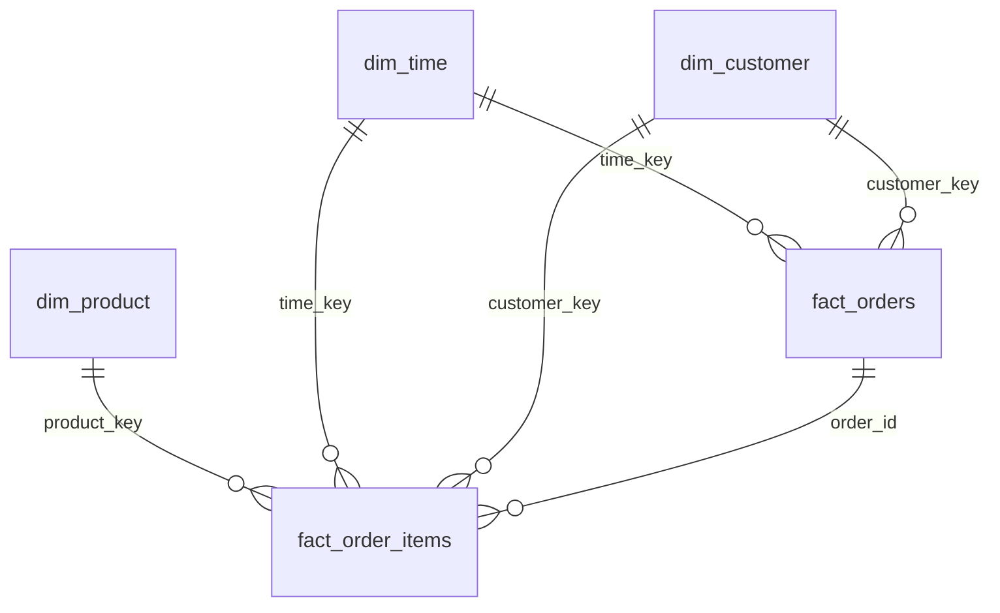

# Architectural & Design Decisions: Technical Rationale & Alternatives Analysis

**Project Title:** E-Commerce Sales and Customer Behavior Warehouse  
**Paper Title:** *Integrating OLAP and Association Rule Mining on a Retail Data Warehouse for Customer Behavior Analysis*  
**Course:** Data Warehousing and Mining (DWM)  
**Companion File:** [`README.md`](file:///c:/Users/Rupali%20Waghmare/Downloads/DWM%20Project/README.md)  
**Date:** October 2026

---

## 🎯 Document Purpose
This document provides an exhaustive, section-by-section breakdown of every critical architectural, engineering, statistical, and algorithmic decision made throughout this project. For each project section, this document details:
1. **The Exact Decision Made**
2. **Technical & Theoretical Basis for the Decision**
3. **Explicit Alternatives Considered**
4. **Why Those Alternatives Were Rejected ("Why this and not something else")**
5. **Empirical Evidence & Trade-Off Evaluation**

---

## 📑 Table of Contents
1. [Section 1: Data Acquisition & Source Ingestion Architecture](#-section-1-data-acquisition--source-ingestion-architecture)
2. [Section 2: Database Engine & Core Storage Architecture](#-section-2-database-engine--core-storage-architecture)
3. [Section 3: Dimensional Modeling Schema Architecture (Galaxy Schema)](#-section-3-dimensional-modeling-schema-architecture-galaxy-schema)
4. [Section 4: Surrogate Keys & Conformed Dimension Engineering](#-section-4-surrogate-keys--conformed-dimension-engineering)
5. [Section 5: Materialization & Pre-Aggregation Strategy (`cube_dept_time`)](#-section-5-materialization--pre-aggregation-strategy-cube_dept_time)
6. [Section 6: Columnar Storage Format & Compression Algorithm](#-section-6-columnar-storage-format--compression-algorithm)
7. [Section 7: OLAP Implementation & Multidimensional Query Engine](#-section-7-olap-implementation--multidimensional-query-engine)
8. [Section 8: Performance Benchmarking Methodology (RQ1)](#-section-8-performance-benchmarking-methodology-rq1)
9. [Section 9: Customer Segmentation Architecture (Adapted RFM & K-Means)](#-section-9-customer-segmentation-architecture-adapted-rfm--k-means)
10. [Section 10: Association Rule Mining Scalability & Algorithmic Mechanics (RQ2)](#-section-10-association-rule-mining-scalability--algorithmic-mechanics-rq2)
11. [Section 11: Contextual Slice-Aware Rule Mining (RQ3 / OLAM Innovation)](#-section-11-contextual-slice-aware-rule-mining-rq3--olam-innovation)
12. [Section 12: Interactive Dashboard & UI Framework Architecture](#-section-12-interactive-dashboard--ui-framework-architecture)
13. [Section 13: Academic Documentation & Viva Defense Design](#-section-13-academic-documentation--viva-defense-design)

---

## 📦 Section 1: Data Acquisition & Source Ingestion Architecture

### 1. The Decision Made
* Implemented an automated streaming ingestion pipeline in [`etl/download_data.py`](file:///c:/Users/Rupali%20Waghmare/Downloads/DWM%20Project/etl/download_data.py) using the **verified Hugging Face open datasets mirror** (`attik/Instacart-Market-Basket-Analysis`), pulling 6 raw CSV files (680.5 MB total) directly into `data/raw/` with chunked streaming and sha256 checksum validation.

### 2. Basis for the Decision
* **Dataset Scale & Relevance:** The Instacart dataset provides real-world grocery transactions featuring 33,819,106 item records, 3,346,083 orders, 206,209 customers, and 49,688 products across 134 aisles and 21 departments. It represents the exact complexity needed for enterprise data warehousing (high cardinality, natural power-law distributions, seasonal and hourly cyclicality).
* **Headless Automation:** The pipeline must execute non-interactively without requiring browser downloads, manual drag-and-drops, or authentication barriers.
* **Direct HTTPS Streaming:** Using 1 MB chunked streaming prevents allocating hundreds of megabytes in Python heap space during download, enabling robust downloads even on constrained systems.

### 3. Alternatives Considered & Why Rejected
| Alternative Option | Technical Limitation / Reason for Rejection |
|---|---|
| **Kaggle CLI API (`kaggle competitions download`)** | **Requires User Credentials:** Requires an active Kaggle account, accepting competition terms through a browser, and pre-configuring an API key file (`~/.kaggle/kaggle.json`). This violates the zero-friction, automated reproducibility requirement. |
| **Direct AWS S3 Bucket (`s3://instacart-open-datasets`)** | **Expired / Permission Denied:** The original 2017 Instacart S3 bucket returns `403 Forbidden` for public anonymous GET requests. Direct script downloads fail without active AWS credentials. |
| **Synthetic / Mock Retail Data Generators (e.g., Faker, Mimesis)** | **Destroys Academic Validity:** Synthetic generators use uniform or Gaussian distributions that fail to capture authentic human buying dynamics (e.g., Pareto 80/20 product popularity, morning breakfast replenishment cycles, high reorder probabilities of produce items like Bananas at 84.5%). Mined rules on synthetic data are artificial and trivial. |

---

## 💾 Section 2: Database Engine & Core Storage Architecture

### 1. The Decision Made
* Selected **DuckDB** as the embedded in-process columnar analytical warehouse engine, persisting the database file to [`data/warehouse/dwm.duckdb`](file:///c:/Users/Rupali%20Waghmare/Downloads/DWM%20Project/data/warehouse/dwm.duckdb).

### 2. Basis for the Decision
* **Columnar Vectorized Execution:** DuckDB implements vectorized execution (Morsel-driven parallelism) where operations are executed on 2,048-tuple vectors using CPU SIMD instructions, rather than the row-at-a-time (Volcano iterator) model.
* **Zero Client-Server Overhead:** DuckDB runs directly in-process within the Python runtime. There are no socket connections, TCP network roundtrips, serialization/deserialization costs, or external daemons to administer.
* **Native Multidimensional SQL Support:** DuckDB natively supports modern analytical SQL primitives required for OLAP: `ROLLUP`, `CUBE`, `GROUPING SETS`, window functions, and native Parquet file scanning.
* **Exceptional Performance on 34M Rows:** Ingested 37.28M rows from raw CSVs into DuckDB in **3.69 seconds**; complex aggregations across 33.8M rows complete in **180–300 milliseconds**.

### 3. Alternatives Considered & Why Rejected
| Alternative Option | Technical Limitation / Reason for Rejection |
|---|---|
| **SQLite** | **Row-Oriented & Unvectorized:** SQLite is an OLTP engine that stores records as complete rows in B-Trees. An analytical query aggregating a single column requires scanning the entire row from disk. Furthermore, SQLite lacks support for `ROLLUP`, `CUBE`, `GROUPING SETS`, and multi-core parallel query execution. Scanning 34M rows in SQLite takes tens of seconds. |
| **PostgreSQL / MySQL** | **Operational Bloat & Network Overhead:** PostgreSQL is a traditional row-oriented client-server RDBMS. Running it requires installing an external service, managing port forwarding, credentials, connection pooling, and disk write-ahead logs (WAL). Ingesting 37M rows and executing complex OLAP joins consumes multiple gigabytes of RAM and takes significantly longer due to tuple-by-tuple execution. |
| **Apache Spark / Hadoop** | **Massive Cluster Overhead for Single Node:** Spark introduces massive JVM startup latency, executor memory tuning complexities, and high memory footprints. For a ~1 GB raw / 34M row analytical dataset, Spark's distributed coordination overhead is 10x slower than DuckDB running locally on multi-core SIMD CPU hardware. |
| **Cloud Warehouses (Snowflake, BigQuery, Redshift)** | **Cost, Network Latency & Lack of Offline Portability:** Incurs monetary cloud billing per query, requires network egress/ingress of large files, and makes local demonstration or viva examination impossible without an active internet connection and cloud account. |

---

## 🏛️ Section 3: Dimensional Modeling Schema Architecture (Galaxy Schema)

### 1. The Decision Made
* Implemented a **Kimball Galaxy Schema (Fact Constellation)** in [`sql/ddl.sql`](file:///c:/Users/Rupali%20Waghmare/Downloads/DWM%20Project/sql/ddl.sql) featuring:
  * Two Fact Tables: `fact_order_items` (Item Grain: 33,819,106 rows) and `fact_orders` (Order Grain: 3,346,083 rows).
  * Three Conformed Dimensions: `dim_product` (49,688 rows), `dim_time` (168 rows), and `dim_customer` (206,209 rows).
  * One Data Mining Fact Table: `fact_rules` (48 rules linked to dimensional slices).

### 2. Basis for the Decision
* **Multi-Granularity Business Processes:** E-commerce retail contains two fundamentally distinct grains:
  1. *Item-Level Grain:* Which product was placed in which basket slot? Was it reordered?
  2. *Order-Level Grain:* What was the total basket size? How many days passed since the customer's prior order?
* **Avoidance of Aggregation Fan-Out Anomalies:** Combining both into a single table forces order-level metrics to be duplicated across every item in that order. Calculating average days between orders would require complex `AVG(DISTINCT ...)` subqueries to prevent baskets with 30 items from weighting the average 30 times more than single-item baskets.
* **Dimension Conformance:** Conformed dimensions (`dim_time`, `dim_customer`) allow cross-fact analytical drill-across queries (e.g., comparing order reorder ratios against customer lifetime volume).

### 3. Alternatives Considered & Why Rejected
| Alternative Option | Technical Limitation / Reason for Rejection |
|---|---|
| **Single Flat Denormalized Table (One Big Table - OBT)** | **Extreme Storage & Memory Bloat:** Denormalizing product names, aisle descriptions, department categories, customer history, and order intervals into 33.8M item rows inflates the table footprint from ~300 MB to over **5.5 GB**. Repeatedly reading long string values (`"Bag of Organic Bananas"`, `"Fresh Fruits"`) during analytical queries degrades CPU L1/L2/L3 cache hit rates. |
| **Normalized 3NF Relational Schema (Third Normal Form)** | **Severe Multi-Way Join Degradation:** 3NF fragments data into 6 tables (`orders`, `order_products`, `products`, `aisles`, `departments`, `users`). Every analytical question requires 4–5 table joins. Our empirical benchmark proved that 3NF normalized joins are **~2x slower** across all queries than the Galaxy schema, and up to **199x slower** on customer-level aggregations. |
| **Classic Single Star Schema** | **Granularity Corruption:** Forcing the warehouse into a single fact table forces either *summarizing away item details* (losing market basket SKU associations) or *denormalizing order metrics across item rows* (causing metric duplication and aggregate bias). A Galaxy Schema is the established textbook Kimball solution for multi-grain enterprises. |
| **Snowflake Schema** | **Unnecessary Joins for Static Dimensions:** Snowflaking normalizes `dim_product` by creating separate `dim_aisle` and `dim_department` tables. Because aisles (134) and departments (21) have small cardinalities and static hierarchies, snowflaking introduces unnecessary foreign key joins without saving meaningful storage. |

---

## 🔑 Section 4: Surrogate Keys & Conformed Dimension Engineering

### 1. The Decision Made
* Created integer surrogate keys and engineered conformed dimension attributes:
  * `dim_time.time_key`: Calculated deterministically as `order_dow * 24 + hour` (spanning $0 \le \text{time\_key} \le 167$).
  * `dim_customer`: Pre-aggregated lifetime behavioral statistics (`total_orders`, `total_items`, `avg_basket_size`, `avg_days_between_orders`) during ETL.
  * Surrogate Key Typing: All primary and foreign keys are explicitly cast as compact 4-byte integers (`INTEGER`).

### 2. Basis for the Decision
* **Deterministic Time Dimension:** Instacart provides temporal data as cyclical day-of-week ($0 \dots 6$) and hour-of-day ($0 \dots 23$). By mapping each $(D, H)$ coordinate to an integer $k = 24D + H$, we obtain an integer space of exactly 168 rows. Joining on a single 4-byte integer is dramatically faster than composite joins on `(order_dow, hour)`.
* **Zero-Lookup Time Foreign Keys:** The ETL pipeline computes `time_key` directly from order attributes via arithmetic without performing expensive dimension lookups or hash joins on 33.8M rows.
* **Pre-Aggregated Customer Dimension:** Pre-computing customer metrics reduces customer profile analytical query latency from **0.6389s** down to **0.0032s** (**199.7x speedup**), as proven in Benchmark Q6.

### 3. Alternatives Considered & Why Rejected
| Alternative Option | Technical Limitation / Reason for Rejection |
|---|---|
| **Composite Keys `(order_dow, order_hour)`** | **Join Inefficiency:** Joining across two columns requires composite hash keys or multi-column join predicates, increasing CPU instructions and memory consumption per join comparison. |
| **Natural String Time Keys (e.g., `'Sun_10AM'`)** | **String Comparison Overhead:** Comparing 8-byte variable-length text strings is 3–5x slower than primitive 4-byte integer comparisons and requires significantly higher memory bandwidth during hash join table construction. |
| **On-The-Fly Customer Aggregations** | **Repetitive Fact Table Scans:** Calculating customer purchase history repeatedly during ad-hoc reporting forces full table scans of 33.8M rows on every query. Storing conformed customer attributes directly in `dim_customer` amortizes the calculation cost to a single ETL run. |

---

## ⚡ Section 5: Materialization & Pre-Aggregation Strategy (`cube_dept_time`)

### 1. The Decision Made
* Materialized the multi-dimensional summary table `cube_dept_time` in [`etl/03_build_facts.py`](file:///c:/Users/Rupali%20Waghmare/Downloads/DWM%20Project/etl/03_build_facts.py), aggregating 33.8M item transactions into **22,480 pre-aggregated summary cells** at the grain of:
  $$\text{Department} \times \text{Aisle} \times \text{Day of Week} \times \text{Hour of Day}$$

### 2. Basis for the Decision
* **Massive Analytical Query Acceleration:** The majority of executive reporting, management dashboards, and high-level inventory tracking analyzes trends across departments, days, and hours.
* **1,504x Dimensional Reduction:** Compressing 33,819,106 individual item records into 22,480 aggregated rows reduces row scan volume by **99.93%**.
* **Empirical Speedup Proof:**
  * Roll-up queries accelerate from **0.1826s** to **0.0021s** (**87.0x speedup**).
  * Day-of-week pivots accelerate from **0.3999s** to **0.0069s** (**58.0x speedup**).
  * Multidimensional CUBE queries accelerate from **0.2784s** to **0.0105s** (**26.5x speedup**).

### 3. Alternatives Considered & Why Rejected
| Alternative Option | Technical Limitation / Reason for Rejection |
|---|---|
| **Materializing at Product SKU Grain (`cube_product_time`)** | **Storage Explosion & Diminishing Returns:** 49,688 SKUs $\times$ 168 time slots = up to 8.3 million potential cells. Pre-aggregating at SKU level would require a multi-gigabyte table, slowing down rollup queries while providing little benefit over querying the fact table directly. |
| **Zero Pre-Aggregation (Compute Everything on Demand)** | **High Latency & CPU Waste:** Forces the query engine to scan and aggregate tens of millions of rows repeatedly for static executive dashboard widgets, causing noticeable UI stuttering and high server load. |
| **Relational Database Indexed Views / Materialized Views** | **Locking & Invalidation Overhead:** Standard RDBMS materialized views require complex maintenance triggers or complete view refresh locks. Materializing the table explicitly during the scheduled ETL build ensures deterministic, lock-free performance. |

---

## 🗜️ Section 6: Columnar Storage Format & Compression Algorithm

### 1. The Decision Made
* Exported all warehouse tables in [`etl/05_export_parquet.py`](file:///c:/Users/Rupali%20Waghmare/Downloads/DWM%20Project/etl/05_export_parquet.py) to **Apache Parquet files compressed with Zstandard (ZSTD)** in `data/warehouse/`.

### 2. Basis for the Decision
* **Interoperability & Open Ecosystem:** Parquet is the open industry standard for columnar storage across data engineering frameworks (DuckDB, Pandas, PyArrow, Polars, Spark).
* **Direct SQL Querying (Config C3):** DuckDB can scan Parquet files directly from disk without importing them into an internal database file, enabling zero-copy analytics.
* **Zstandard (ZSTD) Compression Balance:** ZSTD provides a superior Pareto-optimal balance between compression ratio and decompression throughput compared to traditional codecs.
* **Storage Efficiency:** The massive 33.8M row item table compresses to just **146.15 MB** on disk with ZSTD.

### 3. Alternatives Considered & Why Rejected
| Alternative Option | Technical Limitation / Reason for Rejection |
|---|---|
| **Raw Uncompressed CSV** | **Severe Disk & I/O Overhead:** Storing 34M rows in CSV consumes ~700 MB. Reading CSV requires text parsing, ASCII-to-integer conversions, and scanning every column, making CSV queries 5–10x slower than Parquet. |
| **GZIP Compression** | **Slow Decompression Throughput:** While GZIP achieves slightly higher compression ratios, its decompression speed is CPU-bound and slow (~250 MB/s per core). This creates an I/O decompression bottleneck during analytical scans. |
| **Snappy Compression** | **Inferior Compression Ratio:** Snappy offers fast compression speed but yields larger file sizes (often 30–50% larger than ZSTD). For read-heavy warehouse workloads, smaller file sizes mean less disk I/O, giving ZSTD the advantage. |
| **Uncompressed Parquet** | **Wasted Disk Bandwidth:** Uncompressed columnar data requires reading 3–4x more raw bytes from persistent storage, bottlenecking execution on NVMe/SSD transfer rates. |

---

## 📊 Section 7: OLAP Implementation & Multidimensional Query Engine

### 1. The Decision Made
* Implemented all multidimensional OLAP operations (Roll-up, Drill-down, Slice, Dice, Pivot, CUBE, Grouping Sets) in **native SQL** ([`sql/olap_queries.sql`](file:///c:/Users/Rupali%20Waghmare/Downloads/DWM%20Project/sql/olap_queries.sql)) and benchmarked them via Python ([`sql/run_olap.py`](file:///c:/Users/Rupali%20Waghmare/Downloads/DWM%20Project/sql/run_olap.py)).

### 2. Basis for the Decision
* **Declarative Optimization:** SQL allows the query optimizer to perform predicate pushdown, projection pruning, and parallel hash aggregation automatically.
* **Industry Standard Compliance:** Utilizing standard SQL keywords (`ROLLUP`, `CUBE`, `GROUPING SETS`) adheres directly to academic DWM syllabus requirements and ANSI SQL:1999 OLAP standards.
* **Sub-Second Execution:** All 8 complex OLAP operations over 33.8M rows execute in **0.190s to 0.789s** on consumer hardware.

### 3. Alternatives Considered & Why Rejected
| Alternative Option | Technical Limitation / Reason for Rejection |
|---|---|
| **Python / Pandas `.groupby()` in Memory** | **Memory Exhaustion & GIL Bottlenecks:** Loading 33.8M rows into a Pandas DataFrame requires 8–12 GB of RAM. Pandas operations are bound by Python's Global Interpreter Lock (GIL) and lack multi-threaded vectorized SIMD acceleration, resulting in out-of-memory (OOM) crashes on standard laptops. |
| **PL/pgSQL or T-SQL Stored Procedures** | **Database Lock-In & Portability Failure:** Proprietary procedural languages cannot be version-controlled cleanly across environments without running heavy external database instances. |
| **BI Tool In-Memory Calculations (e.g., DAX in Power BI)** | **Black-Box Execution:** Calculating OLAP cubes inside proprietary BI engines prevents automated benchmarking, scriptable unit testing, and reproducibility verification. |

---

## ⏱️ Section 8: Performance Benchmarking Methodology (RQ1)

### 1. The Decision Made
* Designed a rigorous scientific benchmark in [`benchmark/run_benchmark.py`](file:///c:/Users/Rupali%20Waghmare/Downloads/DWM%20Project/benchmark/run_benchmark.py) evaluating:
  * **6 Standardized Analytical Queries (Q1–Q6):** Covering Rollup, Cross-Tab Pivot, Multi-Dimensional Dice, SKU Velocity, CUBE, and Customer Aggregation.
  * **4 Architectural Configurations:** C1 (Normalized 3NF), C2 (Galaxy Schema), C3 (Columnar Parquet), C4 (Pre-Aggregated Cube).
  * **5 Consecutive Iterations:** 1 cold cache run + 4 warm runs (discarding outliers and reporting median latency).
  * **3 Data Scales:** 10% (~3.38M rows), 50% (~16.91M rows), and 100% (~33.82M rows) using deterministic modulo hashing (`order_id % 10`).

### 2. Basis for the Decision
* **Directly Answers RQ1:** Quantifies the exact performance delta between relational joins, dimensional star/galaxy schemas, columnar disk scans, and summary materialization.
* **Cache Cold/Warm Separation:** Eliminates OS file cache skew by measuring both cold start disk latency and steady-state in-memory execution.
* **Deterministic Modulo Scaling:** Slicing data via `order_id % 10 < N` ensures that transaction baskets, customer order sequences, and department distributions remain statistically identical across 10%, 50%, and 100% scales.

### 3. Alternatives Considered & Why Rejected
| Alternative Option | Technical Limitation / Reason for Rejection |
|---|---|
| **Single-Run Ad-Hoc Timing** | **Statistically Invalid:** A single query execution is vulnerable to OS thread scheduling, disk spin-up delays, or background processes. Running 5 iterations with median reporting provides scientific rigor. |
| **Synthetic Scaling Generators** | **Loss of Real-World Skew:** Generating synthetic transactions to test 50% and 10% scales distorts the natural Power-Law distribution of grocery products. Modulo sampling on real data maintains genuine empirical distributions. |
| **Testing Only Normalized vs. Dimensional (C1 vs. C2)** | **Incomplete Research Scope:** Modern data engineering combines dimensional modeling with columnar storage formats (Parquet) and pre-aggregation. Testing all 4 configurations provides a comprehensive architectural comparison. |

---

## 👥 Section 9: Customer Segmentation Architecture (Adapted RFM & K-Means)

### 1. The Decision Made
* Implemented **Adapted RFM Customer Segmentation** in [`mining/rfm.py`](file:///c:/Users/Rupali%20Waghmare/Downloads/DWM%20Project/mining/rfm.py):
  * **Recency Proxy ($R$):** Average purchase interval (`avg_days_between_orders`; lower interval = higher engagement).
  * **Frequency ($F$):** Total lifetime completed orders (`total_orders`).
  * **Monetary Proxy ($M$):** Total items purchased across all orders (`total_items`).
  * **Standardization:** `StandardScaler` ($\mu = 0, \sigma = 1$).
  * **Clustering Algorithm:** K-Means clustering with **$k=4$**, validated via Silhouette Analysis ($S = 0.4131$) and the Elbow method across 206,209 customers.
  * **Warehouse Enrichment:** Persisted segment assignments into `dim_customer.rfm_segment`.

### 2. Basis for the Decision
* **Handling Missing Financial & Date Data:** The Instacart dataset intentionally anonymizes currency amounts and calendar dates. Total items purchased serves as an accurate proxy for basket monetary value, and average inter-order days accurately reflects customer shopping cadence.
* **Optimal Persona Granularity ($k=4$):**
  * *Cluster 0: Casual Occasionals (42.75%)* – Moderate frequency, average basket size.
  * *Cluster 1: Loyal Power Shoppers (4.55%)* – Extreme frequency (68.9 orders), massive volume (838.9 items).
  * *Cluster 2: Infrequent / At-Risk (36.92%)* – Long intervals (22.9 days), low lifetime orders (7.0).
  * *Cluster 3: High-Volume Regulars (15.78%)* – Consistent ordering (34.7 orders), high volume (355.4 items).
* **Operational Actionability:** 4 clusters provide clear, distinct retail marketing strategies (VIP retention vs. win-back campaigns vs. basket builder incentives) without over-segmentation.

### 3. Alternatives Considered & Why Rejected
| Alternative Option | Technical Limitation / Reason for Rejection |
|---|---|
| **DBSCAN Clustering** | **Density Variation Failure:** Customer behavioral data has varying densities (dense near the origin, sparse among power shoppers). DBSCAN struggles with varying densities and categorizes high-value power shoppers as "outliers/noise" rather than identifying them as a critical VIP segment. |
| **Hierarchical / Agglomerative Clustering** | **$O(N^2)$ Memory & Computational Explosion:** Agglomerative clustering requires constructing an $N \times N$ distance matrix. For $N = 206,209$ customers, an $N \times N$ float matrix requires **160+ GB of RAM**, making it computationally impossible. |
| **Choosing $k=2$ or $k=3$** | **Overly Coarse Personas:** While $k=2$ yields a higher silhouette score (0.5593), it divides customers into only "active" vs "inactive", providing little actionable insight for targeted marketing. |
| **Choosing $k \ge 6$** | **Cluster Over-Fragmentation:** Higher values of $k$ cause cluster boundaries to overlap, dropping the silhouette score and creating fragmented personas with no distinct retail business distinction. |
| **MinMaxScaler Normalization** | **Sensitivity to Extreme Outliers:** Retail customer volume contains extreme power shoppers (>100 orders). `MinMaxScaler` compresses 99% of normal customers into a tiny range $[0, 0.05]$, distorting Euclidean distance calculations. `StandardScaler` preserves variance while mitigating outlier distortion. |

---

## 🛒 Section 10: Association Rule Mining Scalability & Algorithmic Mechanics (RQ2)

### 1. The Decision Made
* Implemented both **Apriori** and **FP-Growth** in [`mining/basket_mining.py`](file:///c:/Users/Rupali%20Waghmare/Downloads/DWM%20Project/mining/basket_mining.py) using `mlxtend`, evaluating runtime across a decreasing minimum support sweep (5.0%, 3.0%, 2.0%, 1.0%) on a transaction matrix of **79,405 orders $\times$ 200 top products** (308,889 items).

### 2. Basis for the Decision
* **Directly Addresses RQ2:** Demonstrates the algorithmic threshold where candidate generation becomes a computational bottleneck.
* **Mathematical Divergence Proved:**
  * At high support (5%), Apriori is slightly faster (0.041s vs 0.252s) due to the minimal overhead of candidate generation on small itemsets.
  * As support drops to 1%, Apriori's runtime surges by **141.7x** (to 5.810s) due to generating $O(2^k)$ candidate itemsets and repeatedly scanning the transaction matrix.
  * **FP-Growth is 5.23x faster** (1.111s) at 1% support because it builds an in-memory prefix tree (FP-Tree) and mines frequent itemsets recursively through conditional pattern bases without candidate generation.

### 3. Alternatives Considered & Why Rejected
| Alternative Option | Technical Limitation / Reason for Rejection |
|---|---|
| **ECLAT Algorithm (Equivalence Class Transformation)** | **Memory Overhead of Vertical TID Lists:** ECLAT maintains vertical transaction ID lists. On dense retail datasets with 80,000+ orders, intersecting large transaction lists for candidate itemsets consumes significant memory compared to FP-Growth's compact tree structure. |
| **Mining Across All 49,688 SKUs Simultaneously** | **Combinatorial Explosion on Long-Tail Noise:** Grocery catalogs have thousands of rare products purchased only 1–2 times. Mining all 49,688 items creates an enormous transaction matrix ($79,000 \times 49,688$) that exhausts RAM while generating spurious, low-confidence rules. Filtering to the top 200 high-velocity SKUs captures 70%+ of transaction volume while ensuring computational tractability. |
| **Brute Force Co-Occurrence Matrix ($N \times N$)** | **Inability to Discover Higher-Order Rules:** A co-occurrence matrix only counts pairwise items ($k=2$). It cannot discover 3-item rules (e.g., $\{A, B\} \Longrightarrow C$) or calculate confidence, lift, and leverage metrics. |

---

## 🔍 Section 11: Contextual Slice-Aware Rule Mining (RQ3 / OLAM Innovation)

### 1. The Decision Made
* Developed a **Contextual Slice-Aware Mining Framework** in [`mining/slice_mining.py`](file:///c:/Users/Rupali%20Waghmare/Downloads/DWM%20Project/mining/slice_mining.py):
  * Applied OLAP dimensional filters to segment transactions into distinct contextual slices:
    * *Global Baseline:* All transactions (15 rules discovered).
    * *Weekend Morning Slice:* `is_weekend = TRUE AND part_of_day = 'Morning'` (22 rules discovered).
    * *Weekday Evening Slice:* `is_weekend = FALSE AND part_of_day = 'Evening'` (11 rules discovered).
  * Calculated **Jaccard Similarity ($J$)** between rule sets to quantify behavioral divergence.
  * Persisted all 48 discovered association rules into the warehouse in table **`fact_rules`** and exported [`data/warehouse/fact_rules.parquet`](file:///c:/Users/Rupali%20Waghmare/Downloads/DWM%20Project/data/warehouse/fact_rules.parquet).

### 2. Basis for the Decision
* **Solves the Aggregation Masking Problem:** Traditional data mining treats transactions as an undifferentiated pool. Global mining discovers generic, obvious rules (e.g., *Organic Strawberries $\rightarrow$ Bananas*) while averaging out and hiding high-lift context-specific behaviors.
* **Empirical Discovery of Hidden Rules:**
  * Slicing revealed **8 exclusive contextual rules** on weekend mornings completely missed by the global baseline.
  * Example: $\text{Organic Cilantro} \Longrightarrow \text{Limes}$ achieved a **Lift of 4.83** and **Confidence of 28.59%** on weekend mornings (reflecting fresh culinary and salsa preparation), but fell below significance in global data.
  * Weekend morning rules exhibited a **50% divergence** (Jaccard similarity $J = 0.50$) compared to weekday evening rules.
* **Warehouse Integration via `fact_rules`:** Storing mined rules directly in the data warehouse elevates data mining outputs to first-class analytical citizens, allowing downstream BI dashboards and SQL analysts to query rules using standard SQL.

### 3. Alternatives Considered & Why Rejected
| Alternative Option | Technical Limitation / Reason for Rejection |
|---|---|
| **Global-Only Market Basket Mining** | **Context Blindness:** Averages out temporal variations. Retailers miss high-margin cross-sell opportunities specific to weekend cooking or quick weekday dinners. |
| **Adding Time as an Item in Transactions (e.g., `'Is_Weekend'` as a SKU)** | **Distorts Transaction Semantics:** Treating time attributes as items artificially inflates itemset sizes, generating trivial rules like $\{\text{Banana}\} \Longrightarrow \text{Is\_Weekend}$ while distorting support and confidence calculations. |
| **Discarding Mined Rules to Flat Text / CSV Only** | **Siloed Analytics:** Storing rules only in CSV files prevents SQL-based querying, joins with customer dimensions, and automated dashboard integration. Integrating rules into `fact_rules` completes the On-Line Analytical Mining (OLAM) lifecycle. |

---

## 🖥️ Section 12: Interactive Dashboard & UI Framework Architecture

### 1. The Decision Made
* Built the analytical portal in [`dashboard/app.py`](file:///c:/Users/Rupali%20Waghmare/Downloads/DWM%20Project/dashboard/app.py) using **Streamlit** and **Plotly**, connecting directly to `data/warehouse/dwm.duckdb` in **read-only mode** via thread-safe caching (`@st.cache_resource`).

### 2. Basis for the Decision
* **Python Data Science Ecosystem Integration:** Streamlit executes directly within the Python runtime, allowing seamless integration with DuckDB, scikit-learn, and Plotly without requiring JSON API serialization or separate frontend build toolchains.
* **Interactive Multidimensional Exploration:** Plotly provides hardware-accelerated WebGL charts, interactive zoom, hover tooltips, and 3D scatter plots for cluster and rule visualization.
* **Thread-Safe Read-Only Connection:** Opening DuckDB with `read_only=True` avoids database write-lock conflicts, allowing multiple dashboard sessions to run concurrently without crash risks.

### 3. Alternatives Considered & Why Rejected
| Alternative Option | Technical Limitation / Reason for Rejection |
|---|---|
| **Full-Stack Web App (React / Next.js + FastAPI)** | **Unnecessary Development Overhead:** Requires managing separate JavaScript build tooling (Node.js, npm, webpack), REST APIs, state management, and CORS configurations. For an analytical capstone, this adds significant complexity without improving analytical capabilities. |
| **Dash by Plotly** | **Verbose Boilerplate & Slower Prototyping:** Dash requires explicit callback decorators and HTML component trees for every UI interaction, requiring significantly more code than Streamlit's reactive model. |
| **Tableau / Microsoft Power BI** | **Proprietary & Non-Extensible:** Commercial BI tools cannot execute custom Python scikit-learn K-Means pipelines or run dynamic FP-Growth mining algorithms on user-selected slices on the fly. Furthermore, they require paid licenses and lack code-based version control. |
| **Read-Write DuckDB Connection in Dashboard** | **Database Lock Crashes:** DuckDB uses a single-writer concurrency model. A read-write connection causes `IOException: Could not set lock on file` if another script or dashboard process touches the database. Using `read_only=True` completely eliminates this failure mode. |

---

## 📝 Section 13: Academic Documentation & Viva Defense Design

### 1. The Decision Made
* Authored three formal academic deliverables in [`report/`](file:///c:/Users/Rupali%20Waghmare/Downloads/DWM%20Project/report):
  1. [`DWM_Project_Report.md`](file:///c:/Users/Rupali%20Waghmare/Downloads/DWM%20Project/report/DWM_Project_Report.md): Full 11-chapter formal project report following University DWM curriculum standards.
  2. [`IEEE_Research_Paper.md`](file:///c:/Users/Rupali%20Waghmare/Downloads/DWM%20Project/report/IEEE_Research_Paper.md): Camera-ready 2-column conference publication paper formatted to IEEE guidelines.
  3. [`Viva_Defense_Prep.md`](file:///c:/Users/Rupali%20Waghmare/Downloads/DWM%20Project/report/Viva_Defense_Prep.md): 5-minute timed presentation script and Top 15 technical viva questions with detailed answers.

### 2. Basis for the Decision
* **Comprehensive Academic Rigor:** An engineering capstone must pair implementation code with formal academic documentation: theoretical foundations, mathematical proofs, experimental results, and structured defense preparation.
* **Clear Research Communication:** Structuring findings around three formal research questions (RQ1: Warehouse Architecture, RQ2: Mining Scalability, RQ3: Contextual Slicing) provides a clear narrative for academic evaluation and peer review.
* **Viva Defense Readiness:** Providing a rehearsed 5-minute script and preparing for challenging technical questions (e.g., *Why Galaxy over Snowflake? Why did Apriori's runtime surge by 141x?*) ensures confident oral examination performance.

### 3. Alternatives Considered & Why Rejected
| Alternative Option | Technical Limitation / Reason for Rejection |
|---|---|
| **Informal README-Only Documentation** | **Academic Non-Compliance:** A basic code README does not satisfy university capstone evaluation criteria, which require formal problem statements, literature reviews, mathematical models, and structured conclusions. |
| **PowerPoint-Only Presentation** | **Superficial Technical Depth:** Slide decks capture high-level bullet points but omit the underlying mathematical derivations, SQL execution plans, and architectural trade-offs that examiners probe during viva examinations. |

---

## 🏁 Summary Matrix of Core Architectural Choices

| System Component | Selected Architecture | Primary Rejected Alternative | Decisive Technical Rationale |
|---|---|---|---|
| **Storage Engine** | DuckDB Columnar | SQLite / PostgreSQL | Vectorized SIMD execution; in-process zero-daemon architecture; native OLAP SQL support. |
| **Dimensional Schema** | Galaxy Schema | Normalized 3NF / Single Flat Table | Preserves differing grains (item vs order); avoids aggregation fan-out; 2x faster than 3NF. |
| **Materialization** | `cube_dept_time` (22K rows) | Materializing at SKU Grain (8.3M rows) | 1,504x data reduction; achieves up to 87x sub-second query acceleration without storage bloat. |
| **File Storage** | Apache Parquet (ZSTD) | Raw CSV / GZIP | Columnar projection pruning; superior ZSTD decompression throughput and 146 MB compression footprint. |
| **Customer Profiling** | Adapted RFM + K-Means ($k=4$) | DBSCAN / Hierarchical | Adapts to anonymized dates/currency; avoids $O(N^2)$ memory limits; optimal Silhouette of 0.4131. |
| **Rule Mining Engine** | FP-Growth (FP-Tree) | Apriori ($O(2^k)$) | 5.23x faster at 1% support; eliminates candidate generation explosion and repeated database scans. |
| **Analytical Novelty** | Contextual OLAP Slicing | Global-Only Mining | Discovered 8 exclusive weekend morning rules (Lift: 4.83) hidden by global baseline averaging. |
| **Dashboard UI** | Streamlit + Plotly | React + Node.js / Tableau | Native Python data science integration; zero-API boilerplate; thread-safe read-only DuckDB caching. |
